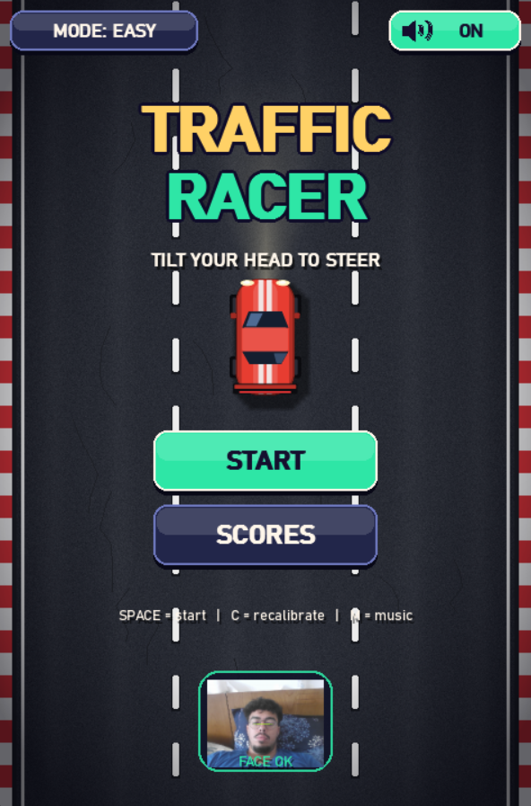
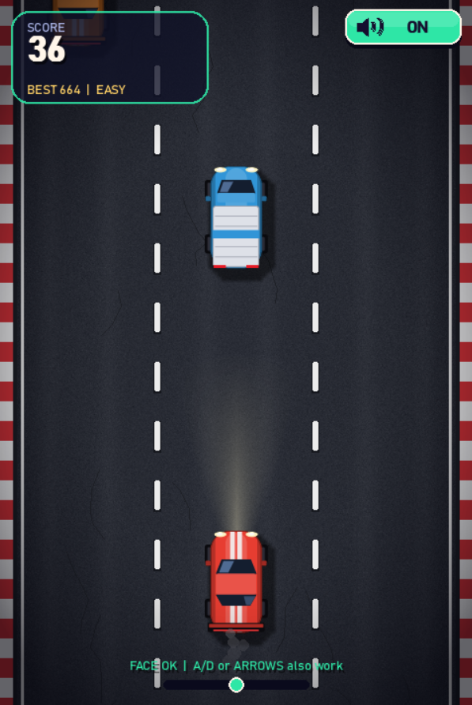
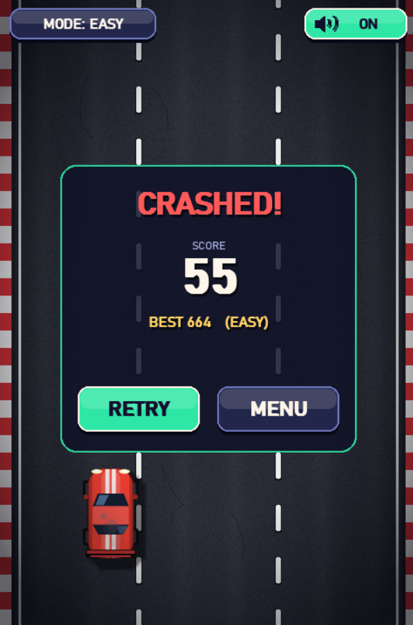
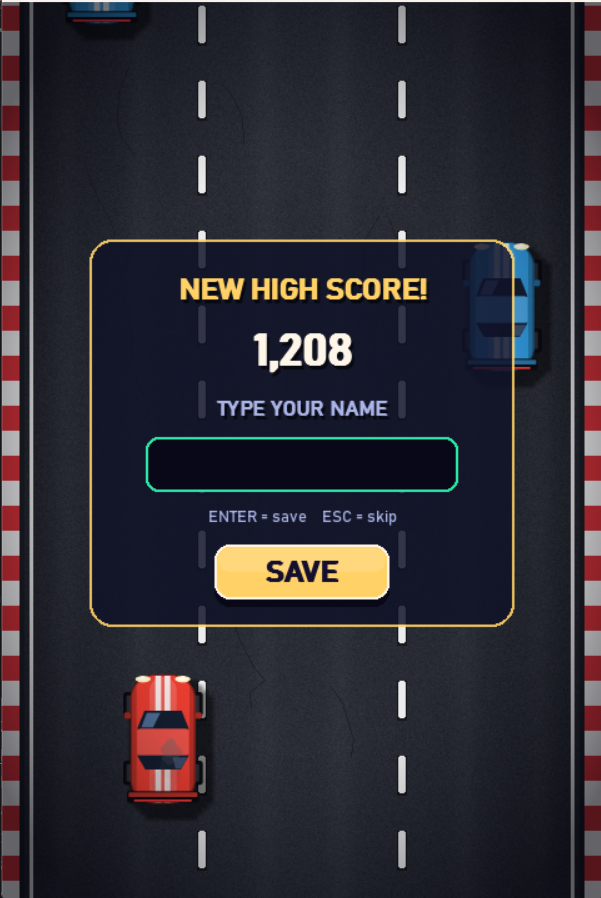
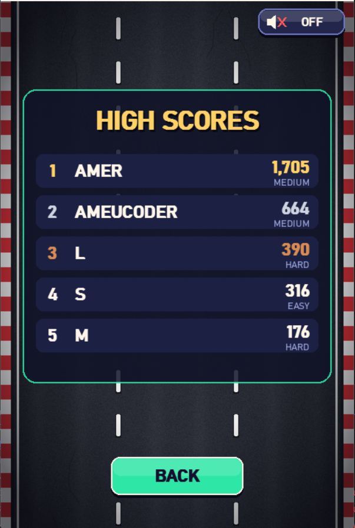

# Head-Tilt Traffic Racer

A 2D top-down traffic dodging game for Python that you steer by **tilting your head**.
Your webcam tracks the angle of your eyes (MediaPipe Face Mesh), the game turns it into steering,
and every sound, car and road texture is generated in code with **pygame + numpy**. No asset files.

## Screenshots

| Menu | Gameplay |
|:---:|:---:|
|  |  |

| Game over | Name entry | High scores |
|:---:|:---:|:---:|
|  |  |  |

## Features

- **Head-tilt steering** with smoothing, a dead-zone and auto-calibration, plus **keyboard fallback** (A/D or arrow keys) if there is no camera
- **3 difficulty modes** (EASY / MEDIUM / HARD) with different speed, traffic density and score multiplier
- **Procedural graphics**: five car styles (sedan, sports car, taxi, truck, police), textured scrolling road, headlight beam, smoke, explosions, speed lines and screen shake
- **Procedural audio**: a 32 s looping synthwave theme, engine hum and crash sound
- **High-score table** (top 5, with name entry) saved to `traffic_scores.json`
- Pause screen, live camera preview and a steering gauge

## Requirements

- Python 3.9+
- A webcam (optional; the game runs on keyboard without one)

```bash
pip install -r requirements.txt   # pygame, numpy, opencv-python, mediapipe
python main.py
```

## Controls

| Input | Action |
|---|---|
| Tilt head left / right | Steer |
| `A` `D` or `←` `→` | Steer with the keyboard |
| `SPACE` / `ENTER` | Start / retry |
| `C` | Recalibrate "straight ahead" to your current head pose |
| `M` | Music and sound on/off (also the button, top right) |
| `ESC` / `P` | Pause / resume (`ESC` also goes back to the menu) |
| Mouse | Click buttons, change mode |

**Tip:** sit upright, look at the camera and press **START**. Your pose at that moment becomes the neutral position.

## Scoring

- **10 points per second** survived × the mode multiplier (EASY ×1, MEDIUM ×1.5, HARD ×2.5)
- **+10 × multiplier** for every car you pass
- If your score makes the top 5, you are asked for a name after the crash

## Project structure

| File | Purpose |
|---|---|
| `main.py` | Entry point |
| `game.py` | Game loop and state machine (menu, playing, paused, dead, name entry, scores) |
| `config.py` | All settings: window, colours, difficulty, steering sensitivity |
| `tracker.py` | Webcam thread (`HeadTracker`) and smoothing/dead-zone (`Steering`) |
| `interface.py` | Fonts, buttons (incl. music button), HUD, panels, screens |
| `cars.py` | Procedural car sprites |
| `road.py` | Seamless scrolling road tile |
| `effects.py` | Particles, speed lines, headlight cone, vignette |
| `entities.py` | Traffic cars and hitboxes |
| `score.py` | High-score storage |
| `music.py` | Theme song generator and play/stop/toggle API |
| `sfx.py` | Engine and crash sounds |
| `synth.py` | Shared numpy synthesis helpers |

## Tuning the steering

In `config.py`:

```python
TILT_RANGE = 0.38      # head roll (radians) that gives full steering; lower = more sensitive
TILT_DEADZONE = 0.04   # ignore tiny wobbles around upright
TILT_SMOOTHING = 9.0   # higher = snappier, lower = smoother
```

Difficulty values live in the `DIFFICULTIES` dict in the same file.

## Using the music in another project

```python
import music
music.preload()          # build the track in the background
music.toggle_music()     # True = playing
music.update()           # call once per frame; starts playback when ready
music.set_volume(0.6)
```

## Troubleshooting

- **"NO CAMERA" in the menu:** another app may be using the webcam, or try another index in `HeadTracker(cam_index=1)`. Keyboard steering still works.
- **"NO FACE FOUND":** improve lighting and keep your face fully in view.
- **No sound:** check that the music button says ON. The theme takes about a second to build the first time.
