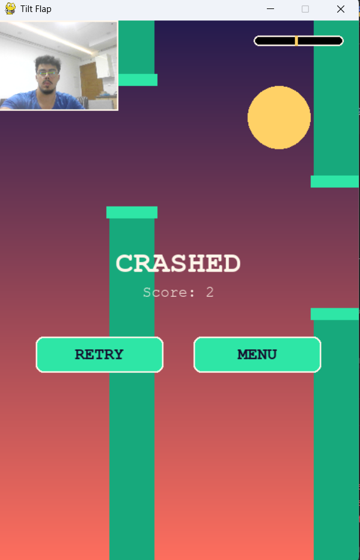
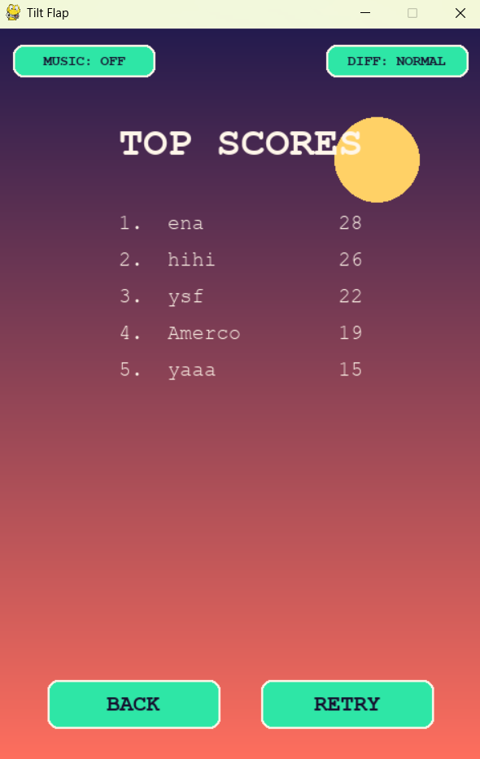

# Tilt Flap

A Flappy Bird clone you play by **tilting your head** in front of a webcam. No clicking, no space bar: tilt left or right and the bird moves up or down.

## Screenshots

<table>
  <tr>
    <td align="center">
      
      <br />
      <sub><b>Gameplay and crash screen</b><br />(webcam preview top left, tilt meter top right)</sub>
    </td>
    <td align="center">
      
      <br />
      <sub><b>Top 5 leaderboard</b><br />(MUSIC and DIFF buttons in the top bar)</sub>
    </td>
  </tr>
</table>

## Setup

```bash
pip install opencv-python mediapipe==0.10.21 pygame numpy
python main.py
```

`mediapipe==0.10.21` is required. This project uses MediaPipe's legacy `mp.solutions.face_mesh` API, which newer releases (0.10.22 and later) removed.

## Controls

| Input | Action |
|---|---|
| **Tilt your head** left or right | Move the bird up or down |
| Mouse | Click START, SCORES, BACK, RETRY, SAVE, and the top-bar MUSIC and DIFF buttons |
| `Enter` | Confirm your name after a top-5 score |
| `Esc` | Quit, or go back from the scores screen |

## Difficulty

The **DIFF** button cycles through three presets. The choice is locked in when a run starts, so changing it never resizes pipes already on screen.

| Mode | Pipe gap | Scroll speed | Pipe spawn interval (s) |
|---|---|---|---|
| EASY | 200 | 140 | 1.9 |
| NORMAL | 160 | 180 | 1.5 |
| HARD | 120 | 230 | 1.15 |

## Built with

| Piece | Library | Role |
|---|---|---|
| Camera capture | `opencv-python` | Reads and mirrors webcam frames, draws the preview |
| Face landmarks | `mediapipe` FaceMesh | 468 landmarks per frame from a pretrained model, no training needed |
| Window, input, rendering | `pygame` | Event loop, drawing, fonts, timing |
| Glue and audio | `numpy` | Converts camera frames for pygame and synthesizes the music |
| Leaderboard | `json` (standard library) | Saves `highscores.json` next to the script |

## Project structure

| File | Responsibility |
|---|---|
| `main.py` | Entry point: `HeadTracker`, `Pipe`, the state machine and the game loop |
| `configuration.py` | Every tunable constant: window size, colors, file paths, tilt sensitivity, the difficulty presets |
| `interface.py` | `Button`, the `draw_*` helpers and `build_funny_song()` |
| `score.py` | `HighScores`: the JSON-backed top 5 |

Keep all files in the same folder, because they import each other by module name.

## How it works

### 1. Head tracking runs on its own thread
`HeadTracker` opens the webcam and FaceMesh and loops on a background thread: read a frame, mirror it, convert BGR to RGB, run FaceMesh. It keeps only the **latest** result (tilt angle, whether a face was found, a small preview frame) behind a lock. The game loop reads it each frame, so slow face detection never makes the game stutter.

### 2. A face becomes a tilt angle
Two FaceMesh landmarks are the outer corners of the eyes (`33` and `263`). The tilt is the angle of the line between them:

```python
tilt = math.atan2(right.y - left.y, right.x - left.x)
```

Level head means about zero. Tilting left or right swings the value positive or negative. That single `atan2` call is the whole gesture recognition.

### 3. Calibration
Everyone sits a little differently, so clicking **START** or **RETRY** stores your current tilt as `neutral`. From then on the game uses `delta = tilt - neutral`, your movement from your own resting pose.

### 4. From tilt to bird movement
```python
delta = clamp(tilt - neutral, -0.5, 0.5)   # limit how far a tilt can push the bird
target_frac = 0.5 - delta                  # map onto 0..1 of the screen height
target_y = target_frac * HEIGHT
```

The bird eases toward `target_y` with a damped velocity instead of snapping to it, which smooths out tracking jitter and gives the bird a floaty, springy feel.

### 5. The game itself
- Pipes spawn on a timer with a random gap position, scroll left, and are removed once off screen.
- A point is scored when a pipe's right edge passes the bird.
- Collisions use rectangle overlap (`pygame.Rect.colliderect`) with each pipe plus a floor and ceiling check.

### 6. Screens and state machine
`state` is always exactly one of:

```
menu -> playing -> dead or name_entry -> scores
```

Every button or key sets `state` to a literal value. An earlier version tracked a separate "previous screen" variable that could point at the wrong place and leave the BACK button stuck, so it was removed.

### 7. Generated music
`build_funny_song()` creates the song in code: note frequencies become a square wave (chiptune feel) with a fast sine "wobble" on top, rendered as raw PCM with NumPy and played through `pygame.sndarray`. The **MUSIC** button toggles it. There are no audio files and no copyright to worry about.

### 8. Leaderboard
`HighScores` loads `highscores.json` on startup, sorted high to low and capped at 5. If a run beats 5th place (or a slot is free) you go to the name-entry screen. Saving re-sorts, trims and writes the file immediately.

## Troubleshooting

- **`module 'mediapipe' has no attribute 'solutions'`:** install `mediapipe==0.10.21`.
- **The bird drifts or doesn't respond:** sit level and press RETRY to recalibrate.
- **No camera or a black preview:** close other apps using the webcam.
