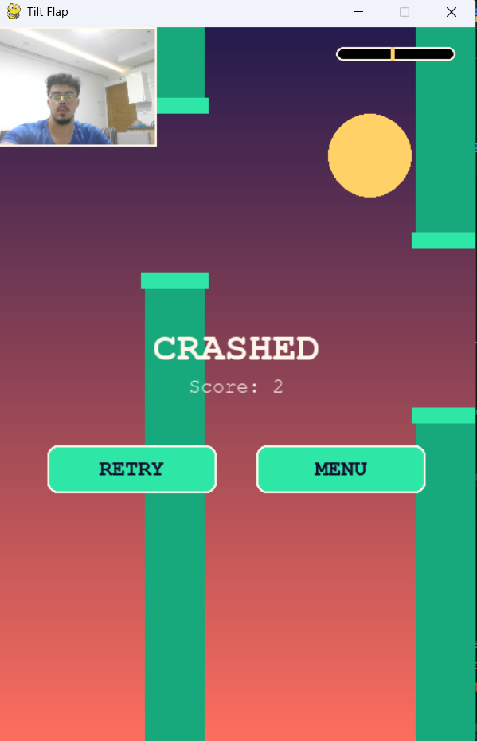
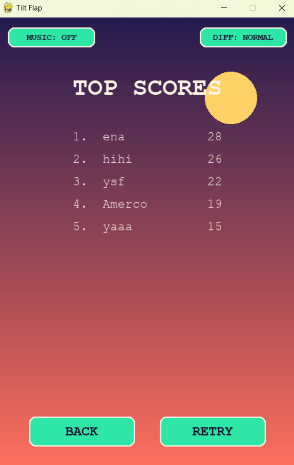

# Tilt Flap

A Flappy Bird clone controlled by tilting your head in front of a webcam,
instead of clicking or pressing space.

## 📷 Screenshots

<table>
  <tr>
    <td align="center">
      
      <br />
      <sub><b>Gameplay / Crash Screen</b></sub>
    </td>
    <td align="center">
      
      <br />
      <sub><b>Top Scores Leaderboard</b></sub>
    </td>
  </tr>
</table>


## What we used

| Piece | Library | Why |
|---|---|---|
| Camera capture | `opencv-python` (`cv2`) | Reads frames from the webcam, flips/converts color, draws the debug overlay on the preview. |
| Face landmark detection | `mediapipe` (`FaceMesh`), pinned to `0.10.21` | Gives 468 3D face landmarks per frame without training any model ourselves. Newer MediaPipe builds (0.10.22+) dropped the legacy `solutions` API this project relies on, so the version is pinned. |
| Game window, input, rendering | `pygame` | Window, event loop, drawing, fonts, timing. |
| Glue | `numpy` | Converts the OpenCV camera frame into a byte buffer pygame can turn into a `Surface`. |
| Leaderboard storage | `json` (standard library) | Reads/writes `highscores.json` next to the script. |

No machine learning was trained for this project — MediaPipe's pretrained
FaceMesh model does all the perception work. The "gesture recognition"
here is a single trigonometry call on two of its output points.

## File structure

The game is split into four files, each with one job:

| File | Responsibility |
|---|---|
| `configuration.py` | Every tunable constant: window size, colors, file paths, head-tracking sensitivity, and the `DIFFICULTIES` presets. |
| `score.py` | `HighScores` — the JSON-backed top-5 leaderboard. |
| `interface.py` | `Button`, all `draw_*` helpers, and `build_funny_song()`, the procedurally-synthesized music. |
| `main.py` | Entry point: `HeadTracker`, `Pipe`, the state machine, and the game loop. Imports the other three. |

Run it with:

```bash
python models.py
```

All four files must stay in the same folder — they import each other by
module name (`import configuration as cfg`, etc.), not by path.

## How it works

### 1. Head tracking runs on its own thread

`HeadTracker` opens the webcam and the FaceMesh model, then loops forever
on a background `threading.Thread`:

1. Read a frame from the camera.
2. Flip it horizontally so it behaves like a mirror.
3. Convert it from OpenCV's BGR color order to the RGB MediaPipe expects.
4. Run `FaceMesh.process()` on it.

This is deliberately **not** on the main thread. Face detection can take
longer than a single 60fps frame budget (~16ms), and we don't want the
game to stutter while the model is thinking. The background thread just
keeps the *latest* result — tilt angle, whether a face was found, and a
small annotated preview frame — behind a lock. The game loop reads
whatever is freshest each frame with `tracker.read()`.

### 2. Turning a face into a tilt angle

MediaPipe's FaceMesh numbers its 468 landmarks consistently. Two of them
are the outer corners of the eyes:

- Landmark `33` — outer corner of one eye
- Landmark `263` — outer corner of the other eye

```python
tilt = math.atan2(right.y - left.y, right.x - left.x)
```

`atan2` gives the angle of the line connecting those two points. Dead
level when your head is straight, and it swings positive or negative as
you tilt left or right. That's the entire tracking "algorithm" — one
`atan2` call per frame on two landmark positions.

### 3. Calibration

Nobody sits perfectly level, and webcams aren't always mounted straight,
so the raw angle from step 2 isn't directly usable — everyone's "neutral"
tilt is a bit different. Clicking **START** or **RETRY** snapshots the
current tilt angle into a `neutral` variable. From that point on, the
game only looks at:

```python
delta = tilt - neutral
```

— how far you've moved from *your own* resting pose, not some fixed
absolute angle.

### 4. Delta → target height → bird velocity

```python
delta = clamp(tilt - neutral, -0.5, 0.5)   # limit how far a tilt can push the bird
target_frac = 0.5 - delta                    # map the delta onto the 0..1 screen height
target_y = target_frac * HEIGHT
```

Rather than teleporting the bird straight to `target_y`, its velocity is
eased toward that target and damped every frame:

```python
bird_vy += (target_y - bird_y) * 0.6 * dt * 60
bird_vy *= 0.9
bird_y += bird_vy * dt + (target_y - bird_y) * 2.5 * dt
```

This is what gives the bird a floaty, springy feel instead of snapping
directly to your head position — small, jittery tracking noise gets
smoothed out instead of making the bird twitch.

### 5. The game loop itself is a standard Flappy Bird

- Pipes spawn on a timer (`SPAWN_EVERY` seconds) with a randomized gap
  position, move left at a constant speed, and get dropped from the list
  once they scroll off-screen.
- Scoring: a pipe counts once its right edge passes the bird's x
  position.
- Collision: simple rectangle-overlap tests (`pygame.Rect.colliderect`)
  between the bird's bounding box and each pipe's top/bottom rectangles,
  plus a floor/ceiling check.

### 6. A small state machine drives the screens

`state` is always exactly one of:

```
"menu" -> "playing" -> "dead" or "name_entry" -> "scores"
```

Every button click or key press sets `state` directly to a fixed string.
Earlier versions of this project tracked a separate "go back to
whichever screen we came from" variable, which could point at the wrong
screen and leave the BACK button stuck — that's why every transition
here targets a literal value instead.

### 7. Difficulty presets

`configuration.py` defines three presets, each controlling the pipe gap
size, scroll speed, and spawn interval for a run:

```python
DIFFICULTIES = {
    "EASY":   {"gap": 200, "speed": 140, "spawn": 1.9},
    "NORMAL": {"gap": 160, "speed": 180, "spawn": 1.5},
    "HARD":   {"gap": 120, "speed": 230, "spawn": 1.15},
}
```

A **DIFF** button in the top bar (menu and scores screens) cycles through
them. The chosen difficulty is only locked in when a run actually starts
(`start_playing()` reads it into `run_gap` / `run_speed` /
`run_spawn_every`), and each `Pipe` stores its own gap size — so changing
difficulty between runs never resizes a pipe that's already on screen.

### 8. The funny song

`interface.build_funny_song()` doesn't load an audio file — it generates
one. A short list of note frequencies is turned into a square wave (for
a chiptune feel) with a fast sine-wave "wobble" layered on top (for the
silly, warbling effect), rendered as raw PCM samples with `numpy`, and
handed to `pygame.sndarray.make_sound()`. The **MUSIC** button in the top
bar just calls `.play(loops=-1)` / `.stop()` on that one generated
`Sound`. No external asset, no copyright to worry about.

### 9. Leaderboard persistence

`HighScores` loads `highscores.json` (next to the script) on startup,
sorted descending, capped at 5 entries. `qualifies(score)` checks whether
a run's score beats the current 5th place (or whether there's still an
empty slot). If it does, the game routes to the name-entry screen instead
of straight to game-over; submitting a name calls `add()`, which inserts,
re-sorts, re-trims, and writes the file back out immediately.

## Steps taken (development order)

1. **Browser prototype first** — an HTML/Canvas version using
   MediaPipe's JS build, to validate the tilt-control feel before writing
   any Python.
2. **Ported to OpenCV + MediaPipe (Python) + Pygame** for a native
   version with live camera access, since the original request was for a
   local, camera-driven build.
3. **Hit and fixed a MediaPipe breaking change** — recent MediaPipe pip
   releases (0.10.22+) removed the legacy `solutions` API this code
   depends on (`mp.solutions.face_mesh`). Fixed by pinning
   `mediapipe==0.10.21`, the last release that still ships it.
4. **Added the leaderboard** — a `HighScores` class backed by a JSON
   file, plus a menu with **START**/**SCORES** buttons and a name-entry
   screen that appears when a run cracks the top 5.
5. **Fixed a state-management bug** — the BACK button on the scores
   screen could get stuck because it relied on a separate `prev_state`
   variable that wasn't always kept in sync. Removed that indirection
   entirely in favor of literal state transitions, and added a RETRY
   button directly on the scores screen as a second way back into a game.
6. **Commented the full source** and wrote this README, to document the
   tracking algorithm and the decisions above for anyone reading the code
   later.
7. **Split into four modules** (`configuration.py`, `score.py`,
   `interface.py`, `main.py`) and added the top-bar **MUSIC** toggle
   (a procedurally-synthesized song, no audio file needed) and **DIFF**
   button (cycles EASY/NORMAL/HARD, adjusting pipe gap, speed, and spawn
   rate for the next run).

## Setup

```bash
pip install opencv-python mediapipe==0.10.21 pygame numpy
python models.py
```

## Controls

- **Mouse** — click START / SCORES / BACK / RETRY / SAVE, and the top-bar
  MUSIC / DIFF buttons (menu and scores screens)
- **Tilt your head** left/right to steer the bird up/down
- **ENTER** — confirm your name after a top-5 score
- **ESC** — quit, or back out of the scores screen

Your top 5 scores are saved to `highscores.json`, created next to the
script the first time you save a score.
