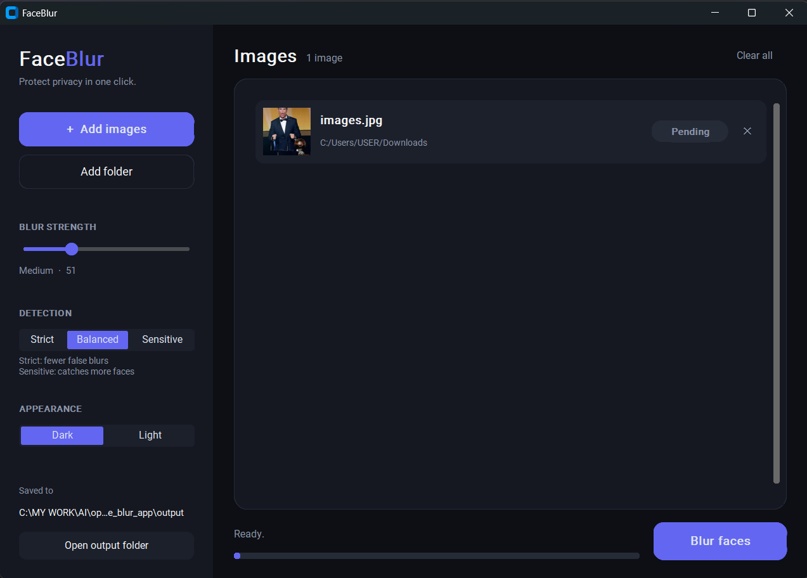

# FaceBlur

**Automatically blur faces in your photos: pick images, click one button, get privacy-safe copies.**

FaceBlur is a small desktop app (Python + OpenCV + CustomTkinter) that finds every face in an image and blurs it. Originals are never touched; the blurred copies are saved to an `output` folder. The detection and blur logic lives in a separate file, `blur.py`, that you can also reuse in your own scripts for photos, videos, webcams and datasets.

---

## Screenshots

### The app



*Add images or a whole folder, choose the blur strength and detection sensitivity, and click **Blur faces**. Each row shows a thumbnail (which turns into the blurred result), the number of faces found, and any errors.*

### Before / after

| Before |                    After                     |
|:---:|:--------------------------------------------:|
|  |  |

*Only the faces are blurred. The rest of the picture stays sharp.*

### Distant faces

Small, far-away faces are caught too (5 faces, from about 100 px down to 14 px wide):

| Before | After |
|:---:|:---:|
|  |  |

---

## Features

- Blur one image, many images, or a whole folder at once
- Finds small, distant and slightly turned faces (YuNet detector built into OpenCV)
- Adjustable **blur strength** and **detection sensitivity** (Strict / Balanced / Sensitive)
- Live thumbnails, per-image face count and error messages
- Dark and light themes
- Works with any file name, including non-English ones
- Never overwrites: if `photo.jpg` already exists in `output`, it saves `photo_1.jpg`
- Fully offline: nothing is uploaded anywhere

---

## Requirements

| | |
|---|---|
| **Python** | 3.9 or newer (with `tkinter`, which is included in the standard Windows/macOS installers) |
| **OS** | Windows, macOS or Linux |
| **Packages** | `opencv-python>=4.8,<5`, `numpy`, `customtkinter>=5.2`, `pillow` |

Install everything with:

```bash
pip install -r requirements.txt
```

> **Important:** use OpenCV **4.x**. OpenCV 5 removed the Haar cascade classifier that FaceBlur keeps as a fallback detector, so `requirements.txt` pins it to `<5`.
>
> **Linux:** if you get `No module named 'tkinter'`, run `sudo apt install python3-tk`.

The two detector model files (`face_detection_yunet_2023mar.onnx`, `haarcascade_frontalface_default.xml`) are included. Keep them next to `blur.py`.

### Run

```bash
python main.py
```

1. Click **Add images** or **Add folder**
2. Choose blur strength and detection sensitivity
3. Click **Blur faces**
4. Open the results with **Open output folder**

---

## Settings

| Setting | What it does |
|---|---|
| **Blur strength** | Size of the blur (11 to 151). Higher = harder to recognize the person. Use *Strong* or *Maximum* for sensitive photos. |
| **Detection: Strict** | Only very confident detections are blurred. Fewest false blurs (statues, trophies, reflections), but a faint or distant face may be skipped. |
| **Detection: Balanced** *(default)* | Good trade-off for most photos. |
| **Detection: Sensitive** | Catches the most faces, including difficult ones, but may blur the occasional non-face object. |

---

## What is `blur.py` useful for?

`blur.py` is the engine of the app, with no interface code in it. Anything that gives you an image as a NumPy array (BGR, the OpenCV format) can use it. The main function is:

```python
blur.blur_face(frame, ksize=51, threshold=0.8)   # -> (frame, number_of_faces)
```

- `frame`: the image (modified in place and returned)
- `ksize`: blur strength, larger = stronger (made odd automatically)
- `threshold`: detection confidence, one of `blur.SENSITIVITY["Strict" | "Balanced" | "Sensitive"]` or any value from 0 to 1

Other helpers: `detect_faces(frame)` (boxes only), `process_images(paths, output_dir, ksize)` (batch), `images_in_folder(folder)`, and `read_image` / `write_image` (safe for non-ASCII paths).

### Problems it solves

| Problem | How `blur.py` helps |
|---|---|
| **Sharing photos of events, streets or crowds** | Blur bystanders before posting on social media or a website |
| **Content creators** (YouTube, Shorts, Reels, vlogs) | Hide passers-by in footage you filmed in public |
| **Privacy laws (GDPR and similar)** | Anonymize people in photos or footage you store or publish |
| **CCTV / security footage** | Blur faces before exporting or sharing clips |
| **Machine-learning datasets** | Remove identities before labeling, sharing or publishing a dataset |
| **Real estate, e-commerce, documentation photos** | Remove people accidentally captured in product or property pictures |
| **Journalism and research** | Protect the identity of sources and participants |
| **Live demos and streaming** | Blur faces from a webcam feed in real time |
| **Your own apps and bots** | Add automatic anonymization to a web backend, Telegram bot, or any pipeline |

### Examples

**One image**

```python
import blur

img = blur.read_image("photos/team_photo.jpg")
img, n = blur.blur_face(img, ksize=51)
blur.write_image("blurred.jpg", img)
print("faces blurred:", n)
```

**A whole folder** (datasets, event photos)

```python
import blur

paths = blur.images_in_folder("photos")
for name, faces, error, out_path in blur.process_images(paths, "output", ksize=51):
    print(name, "->", error or f"{faces} face(s) blurred")
```

**A video file** (CCTV, vlogs)

```python
import cv2
import blur

cap = cv2.VideoCapture("input.mp4")
fps = cap.get(cv2.CAP_PROP_FPS) or 30
size = (int(cap.get(cv2.CAP_PROP_FRAME_WIDTH)), int(cap.get(cv2.CAP_PROP_FRAME_HEIGHT)))
out = cv2.VideoWriter("blurred.mp4", cv2.VideoWriter_fourcc(*"mp4v"), fps, size)

while True:
    ok, frame = cap.read()
    if not ok:
        break
    frame, _ = blur.blur_face(frame)
    out.write(frame)

cap.release()
out.release()
```

**Live webcam**

```python
import cv2
import blur

cap = cv2.VideoCapture(0)
while True:
    ok, frame = cap.read()
    if not ok:
        break
    frame, _ = blur.blur_face(cv2.flip(frame, 1))
    cv2.imshow("Live privacy blur  (press q to quit)", frame)
    if cv2.waitKey(1) & 0xFF == ord("q"):
        break
cap.release()
cv2.destroyAllWindows()
```

> Speed: in my test, 1280×720 video processed at roughly 15 frames per second on a plain CPU. Smaller frames (such as a 640×480 webcam) are faster.

### How the detection works

1. **YuNet** (a small neural-network face detector built into OpenCV) scans the full-resolution image, so even tiny faces are found. Photos larger than 3000 px are shrunk for detection only.
2. Detections below the confidence threshold are dropped. Very small faces get a gentler threshold, because distant faces always score lower.
3. Each face box is enlarged by 12% (to cover hairline, ears and chin) and blurred with a Gaussian blur.
4. If the YuNet model can't be loaded, the older **Haar cascade** is used as a fallback.

---

## Limitations (read this for sensitive photos)

- **No detector is perfect.** Faces that are very small (under about 12 px), turned fully away, or hidden by masks or sunglasses can be missed. For anything sensitive, look at the results before publishing.
- **Blur is not guaranteed to be irreversible.** A light blur can sometimes still be recognizable. Use the *Strong* / *Maximum* settings, or black out the region, when identity protection really matters.
- **False blurs can happen** on face-like objects (statues, shiny trophies, posters). Switch detection to *Strict* if that happens.

---

## Troubleshooting

| Problem | Fix |
|---|---|
| `OpenCV has no CascadeClassifier` / detector errors | `pip install "opencv-python>=4.8,<5"` |
| `No module named 'tkinter'` (Linux) | `sudo apt install python3-tk` |
| A face wasn't blurred | Set detection to **Sensitive** and re-run (use *Clear all* first, since finished images are skipped) |
| A non-face object was blurred | Set detection to **Strict** |
| "Failed: not a readable image" | The file is corrupted or not an image |

---

## Project structure

```
face_blur/
├── main.py                              # CustomTkinter interface
├── blur.py                              # face detection + blur logic (reusable)
├── face_detection_yunet_2023mar.onnx    # main face detector (YuNet)
├── haarcascade_frontalface_default.xml  # fallback face detector
├── requirements.txt
├── screenshots/                         # images used in this README
└── output/                              # blurred results (created on first run)
```

## Credits

Face detection models come from the [OpenCV](https://opencv.org) project and the [OpenCV Zoo](https://github.com/opencv/opencv_zoo) (YuNet). The interface uses [CustomTkinter](https://github.com/TomSchimansky/CustomTkinter).
