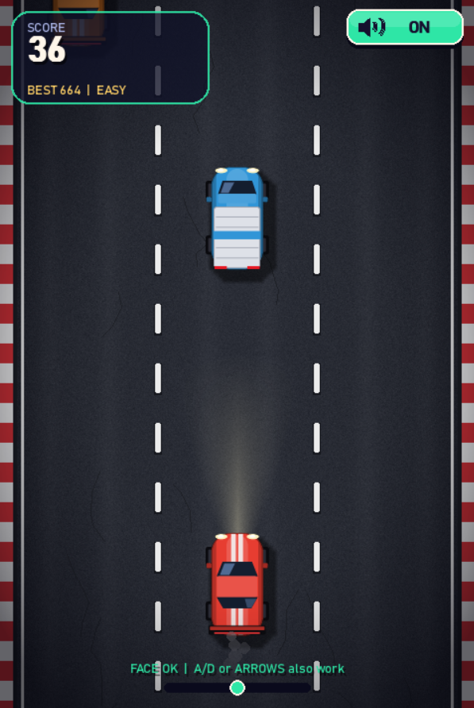
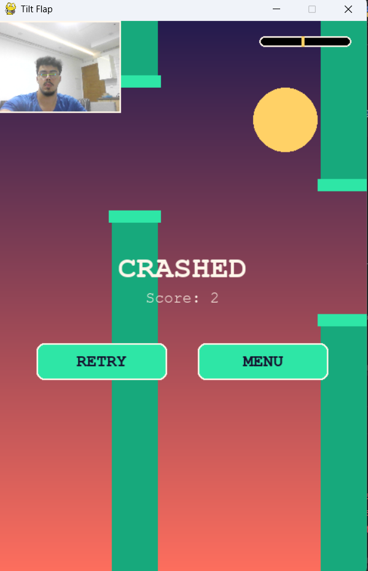
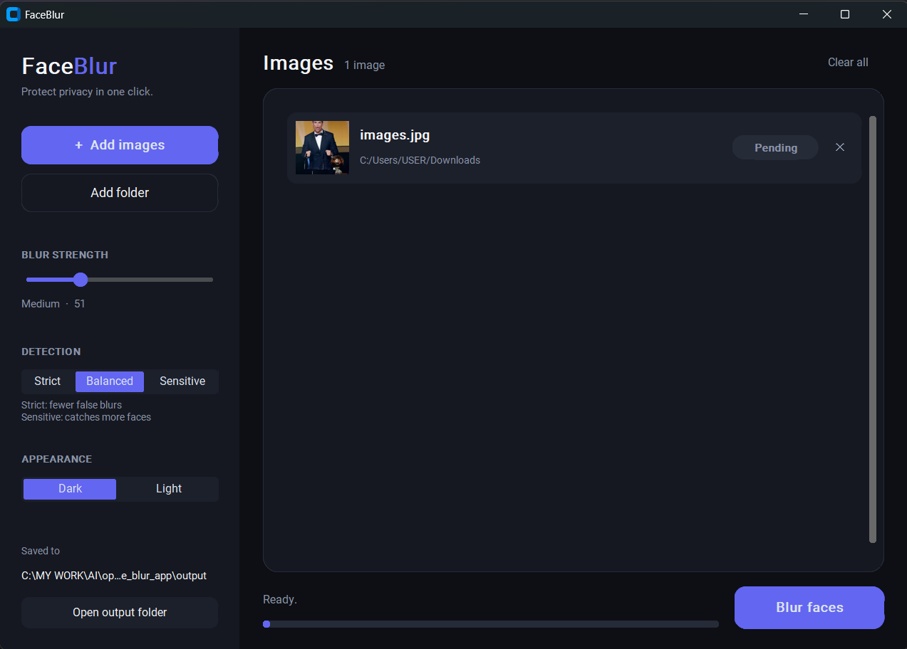

# Computer Vision


**Ten real-time computer vision projects in Python.** Steer a car by tilting your head, switch filters with your fingers, blur every face in a folder of photos, or turn a webcam into a security monitor. Built with OpenCV, MediaPipe, YOLO, NumPy, Pygame and Tkinter. The focus is practical, real-time image processing that balances accuracy with speed.

<!-- TIP: add a 10-15 second demo GIF here (for example docs/demo.gif) showing the head-tilt game, the gesture filters and Air Draw. -->

<table>
  <tr>
    <td align="center" valign="top">
      <a href="./GameVision/2D-Car-Game"></a>
      <br /><sub><b>Head-Tilt Traffic Racer</b><br />steer with your head</sub>
    </td>
    <td align="center" valign="top">
      <a href="./GameVision/FlappyBird"></a>
      <br /><sub><b>Tilt Flap</b><br />Flappy Bird by head tilt</sub>
    </td>
    <td align="center" valign="top">
      <a href="./ImgVision/face_blur"></a>
      <br /><sub><b>FaceBlur</b><br />batch face blurring app</sub>
    </td>
  </tr>
</table>

## Start here

- **Something fun?** Play [Head-Tilt Traffic Racer](./GameVision/2D-Car-Game) or [Tilt Flap](./GameVision/FlappyBird) with just your head.
- **Hands-free control?** Try the [Hand Gesture Filter Camera](./HandVision/HandVision-filters) or [Air Draw](./HandVision/Air-Draw).
- **Something useful?** Use [FaceBlur](./ImgVision/face_blur) to anonymize photos, or [WatchDog](./SafetyVision/WatchDog) as a webcam security monitor.

## Projects

| Project | Category | What it does | Built with |
|---|---|---|---|
| [**Hand Gesture Filter Camera**](./HandVision/HandVision-filters) | HandVision | Switch live filters by holding up 0-5 fingers, hands-free photo countdown, video recording. | OpenCV, MediaPipe |
| [**Air Draw**](./HandVision/Air-Draw) | HandVision | Draw in the air with your index finger; two fingers erase, a fist clears the canvas. | OpenCV, MediaPipe |
| [**Rock-Paper-Scissors**](./HandVision/Rock-papper-scissors) | HandVision | Play against the computer with your real hand, with a countdown and scoreboard. | OpenCV, MediaPipe |
| [**Sign Identification**](./HandVision/Sign-Identification) | HandVision | Recognizes 11 hand signs (fist, peace, thumbs up, OK, ...) with rule-based geometry and no training data. | OpenCV, MediaPipe |
| [**SnapProps**](./FaceVision/SnapProps) | FaceVision | Face-tracked AR props that follow your head: glasses, crown, mustache, clown nose, devil horns, dog ears, plus countdown photo capture. | OpenCV, MediaPipe Face Mesh |
| [**Tilt Flap**](./GameVision/FlappyBird) | GameVision | Flappy Bird you play by tilting your head. Three difficulty modes and a top-5 leaderboard. | OpenCV, MediaPipe, Pygame |
| [**Head-Tilt Traffic Racer**](./GameVision/2D-Car-Game) | GameVision | Steer a car through 3-lane traffic by tilting your head. All sound and graphics are generated in code. | OpenCV, MediaPipe, Pygame, NumPy |
| [**FaceBlur**](./ImgVision/face_blur) | ImgVision | Desktop app that blurs every face in your photos, one by one or a whole folder at once. Finds small, distant faces and has adjustable blur strength and detection sensitivity. | OpenCV (YuNet), CustomTkinter |
| [**Background Outpainter**](./ImgVision/outpainting) | ImgVision | Extends the background of photos to any resolution (Reels, Instagram, 4K, A4) for many photos at once, with a live preview. | OpenCV, NumPy, Tkinter |
| [**WatchDog**](./SafetyVision/WatchDog) | SafetyVision | Webcam security monitor: detects people with YOLOv4-tiny, sounds an alarm, sends phone notifications and counts people leaving the frame. | OpenCV (DNN), YOLOv4-tiny |

> `DocVision` and `RadarVision` are reserved for upcoming projects.

## Quick start

Python 3.9-3.12 is recommended.

```bash
git clone https://github.com/AMEUCODER/Computer-Vision-py.git
cd Computer-Vision-py

python -m venv venv
# Windows
venv\Scripts\activate
# macOS / Linux
source venv/bin/activate

pip install -r requirements.txt
```

Then open any project folder and run it (each folder has its own README with controls):

```bash
cd HandVision/HandVision-filters
python main.py
```

### Projects that need extra packages

`requirements.txt` covers the hand, face and game projects. Three projects need a little more:

| Project | Extra setup |
|---|---|
| **FaceBlur** | `pip install customtkinter pillow` |
| **WatchDog** | `pip install playsound==1.2.2 requests` (the newest `playsound` fails to install on recent Python versions, so use 1.2.2) |
| **Background Outpainter** | Nothing extra. Tkinter ships with Python. On Linux: `sudo apt install python3-tk` |

### Important: MediaPipe version

The hand and face projects use the legacy `mp.solutions` API (`mp.solutions.hands`, `mp.solutions.face_mesh`), which was removed in newer MediaPipe releases. `requirements.txt` pins `mediapipe==0.10.21`, the last version that still ships it. If you see `AttributeError: module 'mediapipe' has no attribute 'solutions'`, you have a newer version installed:

```bash
pip install mediapipe==0.10.21
```

### Troubleshooting

| Problem | Fix |
|---|---|
| Camera doesn't open, or the wrong camera opens | Change `CAMERA_INDEX` in the project's `config.py` (or the number in `cv2.VideoCapture(0)` in `main.py`). Try 0, 1 or 2. |
| `No module named 'tkinter'` (Linux) | `sudo apt install python3-tk` |
| `module 'mediapipe' has no attribute 'solutions'` | `pip install mediapipe==0.10.21` |
| `No module named 'customtkinter'` / `'playsound'` | See "Projects that need extra packages" above |

## Tech stack

| Library | Used for |
|---|---|
| **OpenCV** | Camera capture, image processing, filters, DNN inference (YOLO), face detection (YuNet, Haar cascade) |
| **MediaPipe** | Pretrained hand and face landmark tracking (21 hand points, 468 face points) |
| **NumPy** | Array math for filters, angles and distances, procedural sound and graphics |
| **Pygame** | Window, input and rendering for the camera-controlled games |
| **Tkinter / CustomTkinter** | Desktop interfaces for FaceBlur and the Background Outpainter |

## Repository structure

```
.
├── HandVision/
│   ├── HandVision-filters/      # finger-count filters, photo + video capture
│   ├── Air-Draw/                # draw in the air
│   ├── Rock-papper-scissors/    # RPS game vs. the computer
│   └── Sign-Identification/     # rule-based hand-sign classifier
├── FaceVision/
│   └── SnapProps/               # face-tracked AR props and filters
├── GameVision/
│   ├── 2D-Car-Game/             # Head-Tilt Traffic Racer (all assets generated in code)
│   └── FlappyBird/              # Tilt Flap: Flappy Bird controlled by head tilt
├── ImgVision/
│   ├── face_blur/               # FaceBlur: batch face-blurring desktop app
│   └── outpainting/             # batch background outpainter with a desktop GUI
├── SafetyVision/
│   └── WatchDog/                # YOLOv4-tiny webcam security monitor with alarm
├── DocVision/                   # reserved
├── RadarVision/                 # reserved
├── requirements.txt
├── LICENSE
└── README.md
```

## Design principles

- **Real-time first.** Detection runs on live video, so speed and responsiveness matter as much as precision.
- **Minimal dependencies.** Core CV libraries only.
- **Readable, commented code.** Each project is meant to be learned from, not just run. Most projects keep their tunable numbers in a `config.py`.
- **Rule-based where possible.** Most gesture logic is geometry over landmarks (joint angles, distances), so there is no dataset to collect and no model to train.

## Feedback

Found a bug or have an idea for a new project? [Open an issue](https://github.com/AMEUCODER/Computer-Vision-py/issues). Feedback is welcome.

## License

[MIT](./LICENSE)
